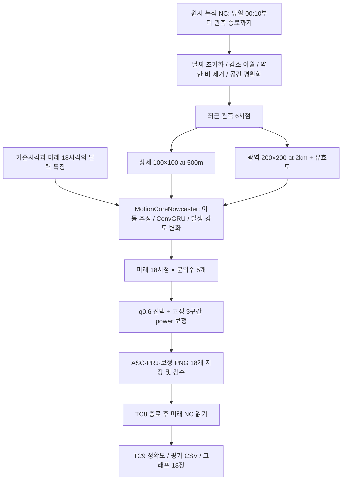

# KlimaX V45 — 1시간 강우 입력, 3시간 예측

최종 학습된 **V45 `MotionCoreNowcaster`**와 최신 **V2 예측·평가 프로그램**을 보관하는 저장소입니다. 10분 간격 강우 6개를 모델에 입력해 미래 +10~180분의 18개 시점을 예측합니다. 선택된 체크포인트와 학습·추론·보정·평가 코드가 포함됩니다. 강우 데이터, 좌표 격자, 실행 결과, EXE와 ZIP은 포함하지 않습니다.

모델은 CNN·ConvGRU·강우 패턴 이동을 결합해 처음부터 학습한 구조입니다. Microsoft ClimaX Transformer의 사전학습 가중치를 미세조정한 모델은 아닙니다. 상세한 구조는 [MODEL.md](docs/MODEL.md), 학습 재현 절차는 [training/README.md](training/README.md)를 참고하세요.

## 현재 버전과 체크포인트

| 항목 | 값 |
|---|---|
| 모델 | V45, 관측 H6 → 미래 18시점 |
| 학습 | scratch, seed 4401, 총 20 epoch / 170,280 update 완료 |
| 배포 체크포인트 | 전역 validation 점수로 선택한 step **85,140** |
| 추론 출력 | q0.6, `float32`, `[18,100,100]`, mm/10분 |
| 분위수 | 0.5, 0.6, 0.75, 0.9, 0.95 |
| 파라미터 수 | 446,047 |
| 실행 프로그램 | V1.1.0 예측 전용 / V2.1.0 예측·평가, 빌드 2026-10-13 |
| 기본 장치 | CPU, CUDA는 명시적으로 지정 |

전체 학습의 마지막 step과 선택된 checkpoint step은 다릅니다. `inference/saved_model.ckpt`는 실제 배포본과 동일하며, 로더가 SHA-256·step·모델 state를 엄격히 확인합니다.

```text
fb7e43c65c38493efdec4f4a4af9649ec7f8149cf0a80f0e9cd552777faae755
```

메타데이터: [docs/checkpoint.json](docs/checkpoint.json).

## 파일 구조

```text
KlimaX_New/
├─ README.md
├─ requirements-inference.txt           검증된 추론 의존성
├─ docs/
│  ├─ MODEL.md                         모델 구조와 시간 조건
│  ├─ checkpoint.json                  최종 선택 체크포인트 정보
│  └─ VALIDATION.md                    검증 사례·기준·성능 한계
├─ inference/
│  ├─ v2_main.py                       최신 V2 실행 진입점
│  ├─ v1_main.py                       같은 예측 경로, 미래 자료 평가 없음
│  ├─ model_config.yaml                입력·출력·장치·시각 설정
│  ├─ saved_model.ckpt                 최종 선택 모델 가중치
│  ├─ correction.py / presets.json     고정 예측 보정
│  ├─ stations_tc.json                 평가 좌표 3개
│  ├─ build_v2.spec                    Windows PyInstaller 빌드
│  ├─ build_shared.spec                공통 코드로 V1·V2 EXE 함께 빌드
│  ├─ src/
│  │  ├─ motion_core_arch.py           모델 정의
│  │  ├─ runtime.py                    checkpoint 검증·추론
│  │  ├─ nc_input.py                   원시 NC → 관측 6프레임
│  │  ├─ preprocess_v27.py             날짜 초기화·Method4C 상태
│  │  ├─ preprocess_context.py         누적 감소 이월·공간 처리
│  │  ├─ ascii_export.py               EPSG:3857 ASC·PRJ 저장
│  │  ├─ png_export.py                 보정 예측 PNG 저장
│  │  ├─ tc9_evaluation.py             저장 ASC 기준 정확도·CSV
│  │  ├─ tc_station_graphs.py          비교 그래프 18장
│  │  ├─ station_graphs.py             그래프 공통 폰트 도우미
│  │  ├─ tc_support.py                 장비·생성 검수·TC8 측정
│  │  └─ test_*.py                     데이터 없는 합성/계약 테스트
│  ├─ input/nc_raw/                    원시 강우 NC를 로컬에 준비
│  ├─ input/data_10m_v45/              lat.npy·lon.npy를 로컬에 준비
│  └─ output/                         실행 시 생성, Git 제외
└─ training/                          학습에 필요한 소스·설정·테스트·문서
```

기본 실행은 최신 V2이고 V1은 같은 예측·보정·저장 경로에서 TC9 전에 종료합니다. V1은 미래 NC를 읽거나 평가 CSV·그래프를 생성하지 않습니다. 학습 코드의 일부 V39/V44 파일명은 상속과 체크포인트 클래스 경로를 유지하기 위해 남아 있습니다.

## 모델 동작



- **상세 입력:** 100×100, 500m, 50km 영역의 관측 강우 6장.
- **광역 입력:** 200×200, 2km, 400km 영역의 관측 강우 6장과 유효한 원본 픽셀 비율. 원시 800×800·500m 영역을 4×4 유효 평균합니다.
- **절대 시간 조건:** 연중 위상과 하루 중 위상의 sin/cos 4개. 기준 시각 1개와 미래 18시각의 달력 특징은 알려진 시각 정보이며, 미래 강우 관측값을 모델에 넣지 않습니다.
- 모델 내부에서는 강우 패턴 이동과 강도 변화·발생 상태를 18회 전개합니다. 상세 출력은 이동한 관측 잔차와 광역 상태를 바탕으로 보정하고, 비음수·순서가 유지되는 분위수로 만듭니다.
- 원시 모델·보정·평가 단위는 **mm/10분**, ASC·예측 지도 표시는 **mm/h**입니다. 저장할 때 6을 곱하고 평가할 때 다시 6으로 나눕니다.

## 입력 데이터 준비

모델이 사용하는 강우 이력은 1시간이지만, 현재 누적 NC 변환은 **당일 00:10부터 입력 종료 시각까지** 필요합니다. 이전 시각의 누적 감소량 상태를 이월하기 때문에 마지막 7개 NC만 단순 차분하는 방식과 다릅니다. 실제 00:00 파일 대신 당일 초기 누적값 0을 사용합니다. 자정 경계를 넘는 입력 이력은 현재 지원하지 않습니다.

`--time`은 **첫 예측 시각**입니다. 다음 예의 `2010`은 입력 종료 `20:00`, 모델 입력 `19:10~20:00`, 예측 `20:10~23:00`을 뜻합니다.

```text
inference/input/nc_raw/
├─ 202208080010.nc
├─ ...
├─ 202208082000.nc       예측에 필요한 누적 NC: 120개
├─ 202208082010.nc
├─ ...
└─ 202208082300.nc       평가용 미래 NC: 추가 18개
```

`nc_raw/20220808/YYYYMMDDHHMM.nc`처럼 날짜 하위 폴더도 지원합니다. 같은 시각 파일이 여러 지원 경로에 중복되면 오류로 처리합니다.

원시 NC는 `data`라는 2차원 변수를 가진 원본 500m 격자이며, 값은 0.1mm 단위의 당일 누적 강우입니다. 코드에서 10으로 나눕니다. 이미 보정된 10분 강우 NC를 원시 누적 NC처럼 입력하면 안 됩니다. 광역 crop은 원본 행 `1046:1846`, 열 `648:1448`, 상세 crop은 행 `1396:1496`, 열 `998:1098`입니다. 다른 영역·격자 데이터에 적용하려면 모델 계약과 좌표를 함께 검증해야 합니다.

`input/data_10m_v45/lat.npy`, `lon.npy`도 별도로 준비합니다. **배포 모델과 동일한 상세 100×100 격자의 원본 좌표**를 사용해야 합니다. 실제 배포 입력 폴더의 좌표 파일을 복사할 수 있습니다. 두 파일은 각 100×100 위도·경도 배열을 사용하며 원시 NC와 같은 방향입니다. 추론 exporter는 기존 배포와 동일하게 `lat[:,0]`, `lon[0,:]`를 사용한 근사 격자로 1km ASC를 구성합니다. 임의의 등간격 위경도를 만들면 저장 위치와 평가 셀이 달라집니다.

미래 NC는 예측 결과 저장 및 TC8 종료 후에만 평가용으로 읽습니다. 없으면 예측 ASC·PNG는 정상 저장하고 TC9 계산 불가, 그래프 0장, 평가 CSV 4개는 헤더만 저장합니다.

## 설치와 실행

추론 검증 환경은 Windows, Python 3.9.25, PyTorch 2.2.2+cu121입니다. 학습 환경은 별도로 [training/README.md](training/README.md)에 설명합니다.

```powershell
git clone https://github.com/jaeyeon1024/KlimaX_New.git
cd KlimaX_New
py -3.9 -m venv .venv
.\.venv\Scripts\Activate.ps1
python -m pip install torch==2.2.2 --index-url https://download.pytorch.org/whl/cu121
python -m pip install -r requirements-inference.txt

cd inference
python v1_main.py --date 20220808 --time 2010
python v2_main.py --date 20220808 --time 2010
python v2_main.py --date 20220808 --time 2010 --repeat 3
python v2_main.py --date 20250813 --time 0810 --device cuda:0
```

GPU 정보 표시와 실제 사용장치는 별개입니다. 기본 설정이 `cpu`라면 GPU가 있어도 CPU로 실행합니다. 경로를 바꾸려면 `model_config.yaml` 또는 `--input-dir`, `--output-dir`, `--config`를 사용합니다. 설정 파일 내부 상대 경로는 실행 소스/EXE 폴더 기준이고, CLI 상대 경로는 현재 작업 폴더 기준입니다. 기본 날짜는 20220808, 첫 예측 시각은 2010입니다.

## 보정 방식

입력 NC 보정과 모델 예측 보정은 별도 단계입니다. 입력에는 Method4C 감소 이월, 0.1mm 이하 약한 비 제거, 유효 픽셀 기반 3×3 총량보존 평활화가 적용됩니다.

예측의 기본 보정은 **모든 날짜에 동일한 공통 3구간 power + 상한 12mm/10분**입니다. `corrected = min(12, gain × prediction^gamma)`를 각 6개 시점에 적용합니다. 프로필 이름은 `shared_three_block_power_cap12`이며 V1·V2가 같은 계수를 사용합니다.

| 예측 리드 | gain | gamma |
|---|---:|---:|
| +10~60분 | 1.8004940607863256 | 1.1000000000000008 |
| +70~120분 | 2.183793013939788 | 1.280000000000001 |
| +130~180분 | 3.538025187345249 | 2.880000000000002 |

이 계수와 상한은 2022-08-08 20:10 및 2025-08-13 08:10의 두 사례 정답으로 함께 선정했습니다. 실행 중 미래 정답으로 재적합하지 않지만 두 사례의 성능은 독립적인 보정 검증 성능이 아닙니다. 날짜·지점에 따라 다른 계수를 선택하지 않습니다. `--correction raw`는 예측 후처리를 생략하며, **입력 NC의 Method4C 변환은 유지**합니다. 이전 2022 전용 계수와 2025 비교용 계수는 명시적 선택 옵션으로 보존했습니다.

## 결과 폴더

```text
inference/output/v2_220808_2010/
├─ run_log.txt
├─ asc_corrected/           ASC 18개 + PRJ 18개, EPSG:3857, 1km, mm/h
├─ png_corrected/           보정 예측 PNG 18장, GT 지도 없음
├─ graphs/                  3개 좌표 기준·예측 비교 그래프 18장
├─ evaluation/
│  ├─ accuracy_table.csv    3좌표 × 18시점 = 54행
│  ├─ station_summary.csv
│  ├─ grid_mapping.csv
│  └─ excluded.csv
├─ converted_input/nc/      모델 입력용 6개 변환 NC
├─ converted_input/npz/     다시 읽어 모델에 넣는 입력 NPZ
├─ prediction_arrays.npz    원래 모델 출력 및 보정 출력
├─ time_alignment.txt       ASC 파일명과 실제 예측 시각 대응
├─ TC8.json
├─ TC8_SUMMARY.json
├─ ACCURACY.json
└─ RUN_METADATA.json
```

같은 날짜·시각으로 다시 실행하면 `_run2`, `_run3` 등이 추가되어 이전 결과를 보존합니다. ASC 이름의 `t0006~t0023`은 입력 6시점 이후의 창 내 번호이며 실제 시각은 `time_alignment.txt`에 있습니다. PNG는 상세 500m 격자, ASC는 집계된 1km 격자이므로 같은 이미지 격자는 아닙니다. 그래프는 시점별로 관측소 3개의 시계열이 누적 표시됩니다.

## TC8 실행시간과 TC9 정확도

**TC8**은 누적 NC 변환 직전부터 전처리·모델 로딩·추론·보정·ASC/PRJ/PNG 저장·생성 검수까지 측정합니다. 미래 정답 읽기와 CSV·그래프 생성은 TC8 종료 후 수행합니다. 동일한 입력·설정·모델·계수·격자·장비·호스트 조건의 최근 3회 평균이 300초 이하이면 통과합니다. 1~2회는 판정 대기입니다. `--repeat 3`은 같은 프로세스의 반복이므로 초기 import는 한 번 발생합니다.

완료 로그의 `초기 로딩`은 프로그램 진입 후 Python import 소요시간입니다. Windows EXE 부트로더까지 포함한 전체 시작 대기시간은 아닙니다. 최신 버전에서는 요청에 따라 상세 전처리·격자 검수 로그를 숨겼으며 실제 검사와 오류 처리는 유지합니다.

**TC9**은 저장된 보정 ASC를 다시 읽어 평가합니다. 기준강우는 평활화하지 않은 원시 누적 NC의 인접 차분을 예측 ASC와 같은 1km 셀로 평균한 값입니다. AWS **410 기상청, 418 한강, 889 현충원**은 위치만 사용하며 AWS 실측 강우량은 사용하지 않습니다.

```text
절대오차 = |예측강우 − 기준강우|
허용오차 = max(1.0 mm/10분, 기준강우 × 0.5)
적중     = 절대오차 ≤ 허용오차
정확도   = 적중 수 / 유효 좌표·시점 수 × 100
오차율   = 절대오차 / 기준강우 × 100  (참고값, 판정 미사용)
```

기준강우 0이면 허용오차 1.0을 적용하고 오차율은 N/A입니다. 음수 차분·결측·NODATA 등 품질 조건을 만족하지 않는 좌표·시점은 제외하며, 제외 이유를 CSV에 기록합니다. 종합 정확도 기준은 80% 이상입니다.

| 날짜 | 모델 입력 | 예측 | 최신 ASC 기준 TC9 |
|---|---|---|---|
| 2022-08-08 | 19:10~20:00 | 20:10~23:00 | 45/54 = **83.3%**, MAE 2.652 mm/10분 |
| 2025-08-13 | 07:10~08:00 | 08:10~11:00 | 44/54 = **81.5%**, MAE 0.645 mm/10분 |
| 2022-08-08 | 15:00~15:50 | 16:00~18:50 | 41/50 = **82.0%**, 제외 4개, MAE 1.481 mm/10분 |

위 값은 새 공통 보정의 3좌표 종합 결과이며 모든 개별 좌표가 80% 이상인 것은 아닙니다. 이전 2022 전용 보정에서 2025는 18/54=33.3%였습니다. 두 사례만으로 일반적인 예측 성능을 보장할 수 없습니다. 과거 native 500m 평가의 90.7%와 현재 1km ASC 평가의 83.3%도 서로 다른 지표입니다. 상세 검증 기록은 [VALIDATION.md](docs/VALIDATION.md)에 있습니다.

V1·V2 별도 배포 폴더와 실제 EXE의 검증 요약은 [release_verification.json](docs/release_verification.json)에 있습니다. V1은 예측 파일만, V2는 같은 예측 파일과 평가 CSV·그래프를 저장합니다. ZIP 안의 두 버전은 각각 EXE·라이브러리·설정·입력 폴더를 갖고 있으며 실제 사용자용 output은 비워 두었습니다.

## 데이터 없이 검사하기

저장소 루트에서 PowerShell로 실행합니다. 합성 배열과 임시 파일을 사용하고 원시 강우 데이터는 필요하지 않습니다.

```powershell
$env:PYTHONPATH = "$PWD\inference;$PWD\inference\src"
python -m unittest discover -s inference/src -p "test_*.py" -v
python inference/src/test_runtime.py --checkpoint inference/saved_model.ckpt
```

두 번째 명령은 실제 체크포인트로 합성 관측 입력을 추론하고 독립 모델 복원 결과·출력 shape·분위수 순서를 비교합니다. 데이터 없는 검사에서 통과한 것과 실제 강우 예측 성능은 구분합니다.

## Windows EXE 빌드

원시 데이터는 EXE에 넣지 않습니다. 위의 좌표 파일을 준비한 Windows 환경에서:

```powershell
python -m pip install pyinstaller==6.21.0
cd inference
python -m PyInstaller --noconfirm build_v2.spec
Copy-Item model_config.yaml dist/V2/model_config.yaml
New-Item -ItemType Directory -Force dist/V2/input/nc_raw
New-Item -ItemType Directory -Force dist/V2/input/data_10m_v45
Copy-Item input/data_10m_v45/lat.npy,input/data_10m_v45/lon.npy dist/V2/input/data_10m_v45/
.\dist\V2\KlimaX_v2.exe --date 20220808 --time 2010 --input-dir C:\your\nc_raw
```

`_internal`을 포함한 `dist/V2` 폴더 전체가 필요합니다. EXE 한 파일만 이동하면 실행되지 않습니다. 이 저장소에서는 빌드 결과를 Git에 올리지 않습니다.

`build_shared.spec`는 같은 분석 결과로 V1·V2를 함께 빌드합니다. `python -m PyInstaller --noconfirm build_shared.spec`의 `dist/runtime`에는 두 EXE와 공통 `_internal`이 생성됩니다. 별도 배포 폴더를 만들 때 각 폴더에 해당 EXE, 전체 `_internal`, 외부 `model_config.yaml`, 로컬 `input/nc_raw`·좌표 격자를 준비합니다. 실제 제공 ZIP은 `KlimaX/V1`, `KlimaX/V2`를 각각 독립 폴더로 구성했습니다.

## 학습 코드와 라이선스

`training/`은 공개용으로 정리한 최소 학습 의존 코드입니다. 데이터와 원본 감사 manifest·sampling index는 별도 준비해야 하며, 임의의 소규모 데이터로 곧바로 실행되는 범용 trainer는 아닙니다. 재학습하면 다른 체크포인트가 생성되므로 현재 고정 SHA·step 검사를 사용하는 배포 로더를 그대로 통과할 수 없습니다.

Microsoft 유래 코드의 MIT 고지는 `training/LICENSE.climax`에 유지합니다. 새 프로젝트 코드 전체의 별도 라이선스는 지정하지 않았습니다.
