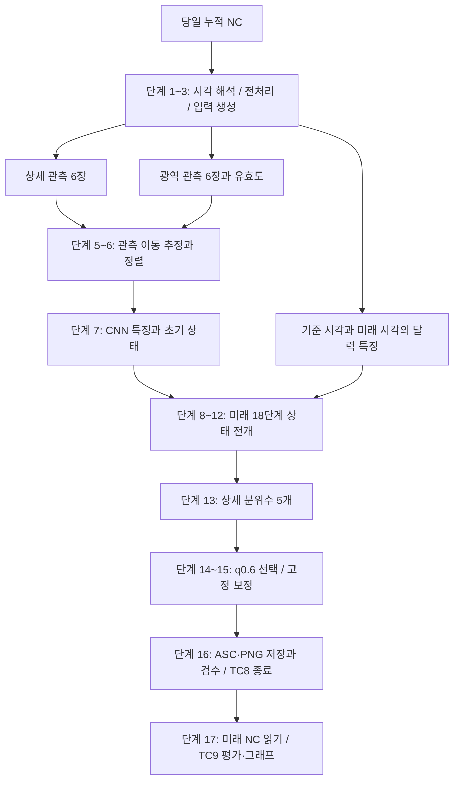

# V45 모델 상세 설명 — 입력부터 예측·평가까지

이 문서는 **최종 V45 `MotionCoreNowcaster`와 최신 V2 실행 프로그램**이 한 번의 예측을 만드는 과정을 코드 실행 순서대로 설명합니다. 기본 예시는 `2022-08-08 20:10` 첫 예측입니다. 각 단계에서 어떤 자료를 읽고, 어떤 계산을 하며, 무엇이 다음 단계로 넘어가는지 구분합니다.

V45는 CNN, ConvGRU, 강우 패턴 이동과 강도 변화·발생 상태를 결합한 **446,047개 파라미터**의 모델입니다. 처음부터 학습한 구조이며 Microsoft ClimaX Transformer의 사전학습 가중치를 미세조정한 구현은 아닙니다.

## 1. 설명에 사용하는 기준과 코드 위치

| 기호 | 의미 | 이번 예시 |
|---|---|---|
| `t0` | 마지막 관측 강우의 종료 시각 | 2022-08-08 20:00 |
| `first_forecast` | 첫 예측 구간의 종료 시각 | 2022-08-08 20:10 |
| `H=6` | 모델에 전달하는 관측 구간 수 | 19:10~20:00의 6장 |
| `L=18` | 미래 예측 구간 수 | 20:10~23:00의 18장 |
| `B` | 배치 크기 | EXE에서는 1 |
| `Q=5` | 분위수 개수 | 0.5, 0.6, 0.75, 0.9, 0.95 |

모든 강우 값은 별도 표시가 없는 한 **mm/10분**입니다. `19:10`의 강우는 `19:00~19:10` 구간 강우를 뜻합니다. 따라서 19:10~20:00이라는 여섯 종료 시각이 대표하는 구간은 총 60분입니다.

| 파일 | 역할 |
|---|---|
| [v2_main.py](../inference/v2_main.py) | 실행 순서, TC8 경계, 예측 후 평가 |
| [nc_input.py](../inference/src/nc_input.py) | 원시 NC 읽기, crop, 모델 입력과 시간 특징 생성 |
| [preprocess_v27.py](../inference/src/preprocess_v27.py) | 당일 누적 0 기준과 날짜 초기화 |
| [preprocess_context.py](../inference/src/preprocess_context.py) | Method4C 감소량 이월, 약한 비 제거, 공간 처리 |
| [runtime.py](../inference/src/runtime.py) | 가중치 검증, 모델 복원, q0.6 선택 |
| [motion_core_arch.py](../inference/src/motion_core_arch.py) | 실제 관측 정렬·상태 전개·분위수 출력 |
| [correction.py](../inference/correction.py) | 모델 이후의 고정 power 보정 |
| [tc9_evaluation.py](../inference/src/tc9_evaluation.py) | 저장 ASC와 기준 NC 차분 비교 |

학습용 [모델 구조 파일](../training/source/ClimaX/src/climax/regional_forecast/motion_core_arch.py)은 추론용 파일과 같은 모델 연산을 구현합니다. 설치·명령어·전체 파일 구조는 [README](../README.md)에 있습니다.

## 2. 전체 흐름을 먼저 보기



**전처리 상태의 시간 범위**, **모델이 보는 강우 관측의 시간 범위**, **평가 자료의 시간 범위**는 서로 다릅니다. 아래 표가 이번 실행의 실제 계약입니다.

| 구분 | 범위 | 모델 예측에 사용 여부 |
|---|---|---|
| 누적 NC 전처리 이력 | 당일 00:10~20:00, 120개 | 최근 6개 강우 입력을 만드는 데 사용 |
| 모델 강우 입력 | 구간 종료 19:10~20:00, 6장 | 사용 |
| 미래 달력·시각 특징 | 20:10~23:00, 18시각 | 알려진 시각 조건으로 사용 |
| 미래 강우 NC | 20:10~23:00, 18개 | 예측 저장 후 평가에만 사용 |

## 3. 단계 1 — 실행 시각과 필요한 파일을 정한다

예를 들어 아래 명령으로 실행합니다.

```powershell
python v2_main.py --date 20220808 --time 2010
```

프로그램은 먼저 다음 값을 계산합니다.

```text
첫 예측 시각 = 20:10
입력 종료 t0 = 첫 예측 시각 - 10분 = 20:00
모델 입력 종료 시각 = 19:10, 19:20, 19:30, 19:40, 19:50, 20:00
미래 출력 종료 시각 = 20:10, 20:20, ... , 23:00
```

입력 누적 파일 이름은 `YYYYMMDDHHMM.nc`입니다. 현재 구현에서는 최근 입력이 모두 `t0`가 속한 같은 날짜 안에 있어야 합니다. 예측 당일의 관측으로 실행하는 경우 첫 예측 `01:10`부터 가능합니다. 첫 예측이 정확히 `00:00`이면 `t0`는 전날 23:50이므로 전날의 이력과 마지막 6개 입력을 사용해 실행할 수 있습니다. 반면 첫 예측 `00:10~01:00`은 해당 입력 기준일의 유효 관측 6개가 모이지 않아 거부됩니다. 입력 이력 6장을 두 날짜에 걸쳐 연결하는 방식은 지원하지 않습니다.

예측 결과가 자정을 넘어가는 경우의 달력 특징은 새 날짜로 계산됩니다. TC9에서는 00:00 구간을 사용할 수 없는 초기화 구간으로 제외하고, 00:10 구간은 그날 누적 0을 기준으로 처리합니다. **입력 이력의 자정 제한과 미래 평가의 초기화 처리는 별개**입니다.

실행 시작 전에 필요한 당일 누적 NC가 모두 존재하는지 확인합니다. 필요한 시각 파일이 없거나 지원하는 여러 경로에 중복되면 오류를 냅니다.

## 4. 단계 2 — 누적 NC를 10분 강우로 바꾼다

### 4.1 원시 값과 공간 범위를 읽는다

`_read_raw()`는 NC의 2차원 `data` 변수를 읽습니다. 원본 값은 **0.1mm 단위의 당일 누적 강우**이므로 10으로 나눕니다. 음수와 9999 이상 값은 결측으로 처리합니다.

원본 500m 격자에서 다음 영역을 자릅니다. 인덱스는 0부터 시작하고 Python slice의 끝 인덱스는 포함하지 않습니다.

```text
광역 원본: 행 1046:1846, 열 648:1448 → 800×800, 400×400km
상세 원본: 행 1396:1496, 열 998:1098 → 100×100, 50×50km
광역 내부 상세 위치: [350:450, 350:450]
```

입력 배열의 행은 원시 NC 방향을 유지합니다. 이 모델 계약에서는 행이 증가하는 방향이 북쪽입니다. ASC 파일은 저장할 때 북쪽 행이 먼저 나오도록 별도로 뒤집습니다.

### 4.2 당일 시작 누적값을 0으로 둔다

실제 00:00 NC를 새 날짜 입력으로 읽는 대신 논리적인 누적 0을 기준으로 00:10부터 처리합니다. `ResetSafeMethod4C`가 날짜 변경과 초기 기준을 관리합니다.

### 4.3 감소량을 상태에 저장하고 뒤의 증가량에서 상쇄한다

단순 차분만 사용하는 경우 누적값의 일시적 감소 뒤 회복분을 새 강우로 잘못 셀 수 있습니다. Method4C는 픽셀마다 `carried_decrease`라는 감소량 상태를 유지합니다.

| 처리 순서 | 누적값 mm | 차분 mm | 남은 감소 이월 mm | 이월 적용 직후 강우 mm |
|---|---:|---:|---:|---:|
| 기준 | 0 | — | 0 | — |
| 1 | 10 | +10 | 0 | 10 |
| 2 | 7 | -3 | 3 | 0 |
| 3 | 9 | +2 | 1 | 0 |
| 4 | 12 | +3 | 0 | 2 |

표의 값은 공간 평활화 전 한 픽셀의 예시입니다. 감소한 3mm는 나중의 증가량 2mm와 1mm로 상쇄됩니다. 마지막 증가 3mm 중 남은 2mm만 새 강우가 됩니다.

결측은 이전에 저장된 누적값의 상태에 따라 처리합니다. 이전 저장 누적값 자체도 결측인 픽셀이 처음 유효해지면 그 시점의 강우를 결측으로 두고 감소 이월을 초기화합니다. 이미 유효한 누적값이 있었다가 중간 관측이 결측인 경우에는 마지막 유효 누적값과 감소 이월 상태를 유지합니다. 다음 유효 관측은 그 유지된 누적값과 차분하므로, 결측을 사이에 둔 증가량이 정확히 한 개의 10분 구간 강우라는 보장은 없습니다. 이런 입력 품질의 한계와 별도로 프로그램은 실제 저장 상태를 그대로 재현합니다. 입력 종료 이전부터 읽어 온 상태가 필요하므로 **마지막 7개 누적 파일만 읽어도 기존 전처리가 정확히 재현된다고 볼 수 없습니다.**

### 4.4 약한 비와 공간 처리를 적용한다

차분·이월 처리 후 0보다 크고 0.1mm 이하인 강우를 0으로 만듭니다. 이후 유효 픽셀 기반 3×3 가중 평활화를 적용하고, 평활화 전후의 유효 영역 총량을 맞춥니다.

이것은 **모델 입력을 만드는 전처리**입니다. TC9 기준강우에는 같은 Method4C 평활화를 적용하지 않습니다.

## 5. 단계 3 — 최근 6개 모델 입력을 만든다

전처리는 00:10부터 수행하지만, 모델에 넘길 배열은 마지막 여섯 강우 프레임만 모읍니다.

| 배열 | 전처리 반환 shape | 모델 전달 shape | 내용 |
|---|---|---|---|
| `fine` | `[6,1,100,100]` | `[B,6,1,100,100]` | native 상세 강우 |
| `context` | `[6,1,200,200]` | `[B,6,1,200,200]` | 광역 강우 |
| `valid` | `[6,1,200,200]` | `[B,6,1,200,200]` | 광역 유효 픽셀 비율 |
| `clock` | `[19,4]` | `[B,19,4]` | 기준·미래 달력 특징 |

광역 강우는 800×800 원본을 4×4 블록으로 나누고 각 블록의 유효 픽셀 평균으로 200×200을 만듭니다. 16개 중 유효 픽셀이 12개라면 유효도는 약 12/16입니다. 저장 시 0~255 정수로 반올림하고, 다시 읽을 때 255로 나눕니다.

상세 강우는 중앙 100×100을 유지하며 결측값을 0으로 저장합니다. 전처리 후 500mm/10분을 넘는 값은 입력 생성 단계에서 결측으로 취급합니다. 광역 배열은 저장 시 float16, 모델에 전달할 때 float32입니다. 유효도가 따로 있으므로 모델은 0이라는 값만 보고 모든 픽셀이 유효하다고 판단하지 않습니다.

변환 NC 6개와 입력 NPZ를 저장한 뒤 **저장한 NPZ를 다시 읽어** 모델 입력을 구성합니다. 배열 크기·유한값·음수 여부를 검사하며, 최신 V2에서 검사 로그를 숨겼어도 실제 검사와 오류 처리는 유지됩니다.

## 6. 단계 4 — 절대 시간 특징과 체크포인트를 준비한다

### 6.1 시각을 네 숫자로 표현한다

`clock_features(timestamp)`는 다음 순서의 값을 만듭니다.

```text
[sin(2π × 연중 위상), cos(2π × 연중 위상),
 sin(2π × 하루 위상), cos(2π × 하루 위상)]

하루 위상 = 당일 경과 초 / 86400
연중 위상 = (0부터 시작하는 일수 + 하루 위상) / 해당 연도의 일수
```

윤년이면 분모는 366입니다. 이 표현은 23:50에서 00:00으로 넘어가는 시각을 주기적으로 표현할 수 있습니다. 네 값은 알려진 달력 정보이며 미래 강우량이 아닙니다. timestamp는 실행 계약상 KST로 해석하며, `clock_features()` 자체가 시간대 변환을 수행하지는 않습니다.

```text
clock[0]  = t0 = 20:00
clock[1]  = 20:10
...
clock[18] = 23:00
```

현재 미래 단계의 조건 계산은 `clock[j+1]`을 사용합니다. 기준 시각 행 `clock[0]`은 입력 배열 계약에 포함되지만 단계 조건에 직접 투입하지 않습니다.

### 6.2 실제 가중치를 엄격히 복원한다

`load_runtime()`은 다음을 검사합니다.

1. 파일 SHA-256이 승인된 V45 checkpoint와 일치하는가.
2. `global_step`이 85,140인가.
3. 모든 모델 state key가 `net.`으로 시작하는가.
4. `net.` 접두사를 제거한 가중치가 실제 모델 구조에 `strict=True`로 맞는가.

```text
SHA-256: fb7e43c65c38493efdec4f4a4af9649ec7f8149cf0a80f0e9cd552777faae755
```

모델을 evaluation 모드와 float32로 설정하고, 추론은 `torch.inference_mode()`에서 실행합니다. 기본 장치는 CPU이며 GPU는 옵션으로 지정합니다. 재학습한 새로운 파일은 이 고정 해시·step 계약을 자동으로 통과하지 않습니다. 최신 source에서는 새 runner가 생성한 `model_contract.json`을 명시적으로 지정해 새 가중치 hash·step·구조·좌표를 검증할 수 있습니다. [전체 실행 안내](END_TO_END.md)에 전처리부터 연결 절차를 설명합니다.

## 7. 단계 5 — 관측의 유효 영역과 인접 이동을 추정한다

여기부터는 `MotionCoreNowcaster.forward()` 안의 계산입니다.

`_observe()`는 광역 `valid >= 0.999`인 셀을 유효 관측으로 사용합니다. 관측 강우가 유한하고 비음수인지도 확인합니다. 비율 입력을 거의 완전한 관측 셀의 보수적인 마스크로 바꾸는 과정입니다.

상세 유효성은 각 native 상세 픽셀이 속한 2km 셀의 유효도에서 전달합니다. 별도로 독립적인 native 결측 마스크를 복구하는 방식은 아닙니다.

광역 강우를 `log1p`로 변환하고 50×50 작업 격자로 평균합니다. 관측 6장은 인접 쌍 5개를 만듭니다.

```text
19:10→19:20, 19:20→19:30, 19:30→19:40,
19:40→19:50, 19:50→20:00
```

`PairMotionEstimator`가 각 쌍의 정방향과 역방향 이동을 CNN으로 추정합니다. 강우의 변화가 항상 이동만으로 설명되는 것은 아니므로, 학습에서는 영상 일치·정역방향 일관성·공간 매끄러움 등의 손실도 사용합니다.

이 이동장의 단위는 **km/10분**입니다. `dx=2`라면 해당 시간 구간의 x방향 이동 2km를 나타냅니다. 이는 강우 영상에서 추정한 패턴 이동이며 실제 관측 풍향·풍속으로 해석하면 안 됩니다.

## 8. 단계 6 — 과거 강우를 t0 좌표로 정렬한다

과거 여섯 영상을 그대로 겹치면 강우가 이동한 자리에 흔적이 여러 개 생깁니다. 모델은 인접 역방향 이동을 연결해 현재 기준 위치에서 각 과거 시각의 원본 위치를 찾습니다.

```text
t0 위치 → 이전 프레임 위치 → 더 이전 프레임 위치
```

연결된 좌표에서 원본 영상을 읽어 `aligned_context`, `aligned_fine`을 만듭니다. 과거 이미지를 반복해서 이동시켜 재표본화하는 대신, 연결한 좌표로 각 원본을 한 번 읽습니다. 경로와 원본의 유효성도 함께 검사합니다.

각 관측 쌍의 정방향 이동을 t0 좌표로 가져온 뒤 성분별 중앙값을 취해 `base_prior`를 만듭니다. 따라서 이동 prior는 최근 한 쌍만의 추정도, 다섯 쌍의 단순 산술 평균도 아닙니다.

이 단계의 핵심 출력은 정렬된 상세·광역 관측, 정렬 유효 마스크, 기준 이동 prior입니다.

## 9. 단계 7 — CNN 특징과 첫 상태를 만든다

| 상태 | shape | 만드는 방법과 용도 |
|---|---|---|
| `wide_h` | `[B,48,50,50]` | 정렬 광역 강우 6채널 + 유효도 6채널을 CNN으로 인코딩 |
| `ground_history_h` | `[B,48,50,50]` | 정렬하지 않은 지상 좌표 관측을 같은 CNN으로 인코딩 |
| `fine_skip` | `[B,32,100,100]` | 정렬 상세 강우 6채널의 공간 특징 |
| `core_h` | `[B,16,50,50]` | 마지막 강우의 중심 확률·강도와 광역 특징을 결합 |
| `rain_material` | `[B,1,200,200]` | 마지막 광역 관측 강우에서 시작하는 상태 |
| `native_residual` | `[B,1,100,100]` | 마지막 상세 강우 − 그 위치에서 읽은 광역 강우 |

광역 encoder는 200→100→50으로 줄이고 상세 encoder는 100×100을 유지합니다. 50×50은 400km 영역의 내부 작업 격자이며, 모델의 최종 500m 상세 출력 격자와 다릅니다.

`core_target()`은 국소 강우 구조와 유효성을 이용한 연속적인 강우 중심 확률을 만듭니다. 개별 폭풍 객체에 ID를 붙여 추적하는 객체 추적기는 아닙니다. 중심 상태의 `heat`는 확률을 안정적으로 전개하기 위한 표현이고 초기 `strength`는 마지막 광역 강우입니다.

학습된 `region_embedding`도 사용합니다. 이것은 위치에 따른 효과를 나타내는 파라미터이며 실제 지형·고도 관측 입력은 아닙니다. 이동하는 강우 특징과 달리 현재 지상 좌표에서 조회합니다.

## 10. 단계 8 — 미래 한 시점의 조건과 ConvGRU 상태를 갱신한다

아래 단계 8~13을 `j=0~17`에 대해 반복합니다. `j=0`은 +10분, `j=17`은 +180분입니다.

```text
cond[j] = lead_embed[j] + clock_proj(clock[:,j+1])
```

`lead_embed[j]`는 몇 번째 미래 단계인지 나타내는 학습 파라미터이고, `clock_proj`는 그 단계의 절대 시각 네 숫자를 16차원으로 변환합니다. 결합한 조건을 광역 50×50과 상세 100×100 격자에 펼칩니다.

광역 ConvGRU는 직전 광역 상태, 강우 중심 상태에서 넘어온 특징, 단계 조건으로 새 광역 상태를 만듭니다. 강우 중심 ConvGRU는 갱신된 광역 상태와 단계 조건을 받아 새 중심 상태를 만듭니다.

ConvGRU는 직전의 공간 상태를 유지하면서 현재 조건에 따라 필요한 정보를 갱신하는 구조입니다. 출력 한 장을 단순히 복사해 18장 만드는 방식이 아닙니다. 미래 정답 강우도 이 반복 과정에 입력하지 않습니다.

## 11. 단계 9 — 광역·상세 이동장을 만들고 좌표를 전개한다

광역 이동은 다음 요소를 결합합니다.

```text
광역 이동 = 관측 이동 prior + 단계별 학습 이동 보정 + 지역 조건 보정
```

상세 영역에서는 광역 특징, 상세 특징, 시간 조건과 지역 조건으로 추가 이동 보정을 만듭니다. 이를 광역 지도에 삽입해 상세 강우를 읽을 별도의 이동장을 구성합니다.

관측 prior head, 단계 보정 head, 상세 보정 head에는 서로 다른 제한이 있습니다. 기본 상수 18·6·2km/10분은 각각 해당 head의 설정이며, **모든 보정을 합친 최종 이동장의 공통 상한**을 의미하지는 않습니다.

좌표 전개에는 midpoint 방식의 기본 3개 substep을 사용합니다. 한 구간의 이동 중간 위치에서 이동장을 다시 읽어 비균일한 이동을 반영합니다.

| 변수 | 뜻 | 사용하는 이유 |
|---|---|---|
| `material_position` | t0의 물질 위치가 미래 어디로 갔는가 | 이동한 물질의 현재 위치에서 지역 효과 조회 |
| `disp`, `fine_disp` | 미래 위치에서 t0 원본의 어디를 읽는가 | 관측 강우·특징·상세 잔차를 누적 이동하여 조회 |
| `step_disp`, `fine_step_disp` | 이번 10분만의 역방향 source map | 이전 단계에 생성된 강우를 다음 단계로 이동 |
| `support`, `fine_support` | 누적 원본 경로가 알려진 영역 안에 있는가 | 관측 자료 밖의 원본을 유효한 강우처럼 읽는 것을 제한 |

정방향 물질 경로와 역방향 원본 조회 map은 서로 다른 계산입니다. 하나를 다른 하나의 단순 부호 반전으로 대체하지 않습니다. 새로 생성된 강우에는 t0부터 누적된 map 대신 자신의 생성 이후 한 구간씩의 이동을 적용합니다.

## 12. 단계 10 — 관측 강우의 강도와 중심 상태를 바꾼다

모델은 관측 강우가 움직이는 동안 유지·강화·약화되는 상태를 전개합니다. 다음 식은 실제 연산의 핵심을 요약한 것입니다. 각 rate는 학습 head와 지역 조건에서 생성됩니다.

```text
heat_new = min(heat_old × exp(growth − death), 20)
core_probability_new = 1 − exp(−heat_new)
strength_new = strength_old × exp(strength_delta)
observed_amplitude_new = observed_amplitude_old × exp(source_rate)

core_change = 0.05 × core_scale
              × (core_probability_new − core_probability_old) × strength_new
rain_material_new = max(rain_material_old × exp(source_rate) + core_change, 0)
```

`source_rate`가 양수이면 관측 강우가 커지고 음수이면 약해집니다. 중심 확률의 변화도 `core_change`를 통해 광역 관측 강우에 반영합니다.

상세 잔차에 나중에 곱할 `observed_amplitude`에는 `exp(source_rate)`만 누적합니다. 중심 변화에 의한 추가량이나 새 강우량까지 상세 잔차에 그대로 곱하는 방식은 아닙니다.

## 13. 단계 11 — 새 광역 강우를 만들고 이전 생성 상태를 이동시킨다

관측 원본 강우의 이동과 별도로, 광역 head가 현재 지상 위치에서 발생 확률과 발생 시 강우량을 만듭니다.

```text
rain_birth_probability = sigmoid(rain_birth_logit)
rain_birth_amount = softplus(amount_head)
rain_birth = rain_birth_probability × rain_birth_amount
```

생성 상태는 강우량·중심 heat·강도의 세 배열입니다. 처음에는 0에서 시작합니다. 각 미래 단계에서 이전 생성 상태를 이번 10분 이동장으로 이동하고, 강도 변화·중심 변화와 이번 단계의 새 발생량을 반영합니다.

`ground_birth_state`는 광역 이동으로 전개하고, `fine_birth_state`는 상세 보정 이동으로 전개합니다. 두 상태 모두 기본 공간은 200×200 광역 격자입니다. `fine_birth_state`라는 이름을 독립적인 native 100×100 발생량 head로 해석하면 안 됩니다.

관측 source map으로 설명되지 않는 영역에는 고정 지상 좌표의 관측 특징을 보조 맥락으로 사용합니다. 생성 상태 자체에 t0 관측 경로의 support를 강제로 곱하지 않아 새로운 강우를 표현할 경로를 둡니다. 이러한 구조가 있다고 해서 실제 관측 밖의 강우를 항상 정확히 예측한다는 뜻은 아닙니다.

광역 출력은 이동·전개된 관측 강우와 생성 강우를 합해 만듭니다.

## 14. 단계 12 — 상세 기준 강우 anchor를 복원한다

먼저 이번 미래 시각의 광역 강우를 상세 50km 영역에서 읽습니다. 상세 보정 이동을 사용하는 생성 상태도 포함합니다.

이어 마지막 상세 관측에서 계산해 둔 native 잔차를 가져옵니다.

```text
native_residual = 마지막 상세 강우 − 같은 위치의 마지막 광역 강우
잔차의 강도 변화 = native_residual × observed_amplitude
미래 상세 잔차 = 위 잔차를 상세 source map으로 읽고 source support 적용
anchor = max(미래 광역 기준 강우 + 미래 상세 잔차, 0)
```

이 단계는 주변의 큰 강우 흐름을 사용하면서 500m 상세 관측에 있던 작은 공간 차이를 전달하는 역할을 합니다. `anchor`는 다음 분위수 decoder의 기준 강우이며 아직 배포용 최종 q0.6은 아닙니다.

## 15. 단계 13 — 상세 decoder에서 순서가 유지되는 분위수를 만든다

상세 decoder의 입력은 `log1p(anchor)`, 광역 특징, 상세 강우 중심 확률·강도, 이동된 상세 특징, 미래 단계 조건입니다. 출력 채널은 강우 분위수 계산용 5개와 발생 보조 logit 1개입니다.

### 15.1 하나의 부호 있는 보정과 양수 간격

`_fine_quantile_readout()`의 계산을 기호로 풀면 다음과 같습니다.

```text
softplus_beta(x) = log(1 + exp(beta × x)) / beta
beta = 8, floor = 0.05
center = inverse_softplus_beta(anchor + floor)
correction = 20 × tanh(raw_correction / 20)
gaps = softplus(raw_gap_1..4)
cumulative = [0, gap1, gap1+gap2, ...]
offsets = cumulative − cumulative[q0.6의 인덱스 1]
base = softplus_beta(center)
delta[q] = softplus_beta(center + correction + offsets[q]) − base
prediction[q] = max(anchor + delta[q], 0)
```

양수 간격의 누적값 때문에 아래 순서가 유지됩니다.

```text
q0.5 ≤ q0.6 ≤ q0.75 ≤ q0.9 ≤ q0.95
```

`correction`은 양수·음수가 모두 가능하므로 기준 강우를 키우거나 줄일 수 있습니다. 20이라는 cap은 좌표 공간의 수치적 제한이며 최종 모든 분위수 강우가 20mm 이하라는 뜻은 아닙니다.

### 15.2 floor가 모든 픽셀에 약한 비를 더하지 않는 이유

`floor=0.05`는 역 softplus 좌표의 안정화에만 사용합니다. 이후 `base`를 빼므로 결과에 고정 0.05mm가 더해지지 않습니다.

q0.6에서는 `offset=0`입니다. `correction=0`이면 `delta=0`이 되어 q0.6은 `anchor`를 유지합니다. `anchor=0`도 같은 관계를 만족하며, 학습된 양수 보정은 무강우 anchor에서 강우를 만드는 경로가 될 수 있습니다.

### 15.3 발생 보조 출력과 최종 강우의 관계

마지막 decoder 채널은 해당 미래 시각의 강우 발생 여부를 학습하는 보조 logit입니다. 발생 확률이나 별도의 native 발생량을 최종 강우에 직접 더하지 않습니다. V45에서는 `fine_birth_amount`와 `fine_new_rain`을 0으로 둡니다.

따라서 **광역 생성 상태는 유지**하면서 **독립 native 발생량의 직접 합산 경로는 제거**한 구조입니다. 발생 보조 손실이 공유 decoder의 학습에 영향을 줄 수는 있지만, 추론에서 발생 확률 자체를 강우량처럼 더하지 않습니다.

## 16. 단계 14 — 미래 18시점을 모으고 q0.6을 선택한다

미래 한 단계마다 상세 분위수 강우를 저장하고 18단계 결과를 쌓습니다.

```text
모델 전체 fine 출력: [B,18,5,100,100]
EXE에서 B=1의 q0.6 선택: [18,100,100]
```

q0.6은 학습된 조건부 분위수 추정입니다. 각 픽셀에서 60%의 확률로 비가 온다는 뜻은 아니며, 다섯 결과의 단순 평균도 아닙니다. 실제 확률 보정의 정확성은 별도 검증이 필요합니다.

`runtime.predict()`는 q0.6 결과가 예상 크기인지, 유한값인지, 비음수인지 확인하고 원래 모델 출력을 float32 mm/10분 배열로 반환합니다.

## 17. 단계 15 — 모델 밖의 고정 예측 보정을 적용한다

분위수 decoder의 보정은 학습된 모델 내부 연산입니다. V2 실행 프로그램은 그 뒤에 별도로 고정 계수의 power 보정을 적용합니다.

```text
corrected = min(12, gain × original_q0.6^gamma)
```

| 미래 시점 | 리드 시간 | gain | gamma |
|---|---|---:|---:|
| 1~6 | +10~60분 | 1.8004940607863256 | 1.1000000000000008 |
| 7~12 | +70~120분 | 2.183793013939788 | 1.280000000000001 |
| 13~18 | +130~180분 | 3.538025187345249 | 2.880000000000002 |

현재 V1·V2 기본값은 모든 날짜에 이 공통 계수를 그대로 사용하고, power 계산 후 native 예측을 최대 12mm/10분으로 제한합니다. 상한은 ASC로 평균하기 전에 적용하며 mm/h로는 72입니다. 실행 중 미래 정답으로 재적합하지 않습니다. 계수와 상한은 2022-08-08 20:10 및 2025-08-13 08:10의 두 정답으로 함께 선정했으므로, 이 두 사례의 보정 후 점수는 독립 일반화 성능이 아닙니다. 기존 2022 전용 계수는 기본값에서 제외하고 명시적 비교 옵션으로 보존했습니다.

`--correction raw`는 이 예측 후처리를 생략합니다. 누적 NC의 Method4C 입력 변환이나 모델 내부의 분위수 decoder를 생략하는 옵션은 아닙니다. 원래·보정 배열은 `prediction_arrays.npz`에 구분해 저장합니다.

## 18. 단계 16 — 결과를 저장·검수하고 TC8을 끝낸다

| 결과 | 공간 표현 | 단위와 개수 |
|---|---|---|
| NPZ 예측 배열 | native 상세 100×100 | mm/10분, 원래·보정 각 18시점 |
| 보정 PNG | native 상세 500m | mm/h 표시, 18장 |
| ASC·PRJ | EPSG:3857, 1km 평균 셀 | mm/h, ASC 18개·PRJ 18개 |

ASC exporter는 배포본과 동일하게 `lat[:,0]`, `lon[0,:]`를 사용한 근사 좌표 격자로 셀을 구성합니다. 강우를 6배 해 mm/h로 바꾸고 같은 1km 셀에 들어가는 유효 상세 픽셀을 평균합니다. 원본 곡선 좌표와 완전히 동일한 2차원 재투영이라고 설명하면 안 됩니다.

ASC는 `t0006~t0023`이라는 창 내 번호를 사용합니다. 이 번호는 6개 입력 뒤의 18개 출력이라는 뜻이며 실제 시각은 `time_alignment.txt`에서 확인합니다. PNG는 실제 예측 시각과 리드를 파일명에 기록합니다. GT 지도는 생성하지 않습니다.

TC8은 누적 NC 변환 직전부터 전처리·모델 로딩·예측·보정·필수 파일 저장·검수 직후까지입니다. ASC/PRJ/PNG가 각각 18개인지, 시간순서·이름·내용·파일 읽기가 정상인지 확인한 뒤 종료합니다. 동일 조건 최근 3회 평균으로 300초 이하 여부를 판정하며 한두 번만 실행했으면 판정 대기입니다.

## 19. 단계 17 — 예측 저장이 끝난 뒤 TC9를 평가한다

여기서 처음 미래 강우 NC를 읽습니다. 저장된 ASC 예측을 다시 읽고 6으로 나누어 mm/10분으로 환산합니다. 기준강우는 원시 누적 NC의 인접 차분을 같은 1km 셀로 평균한 값입니다. 첫 기준 20:10은 입력 종료의 20:00 NC와 차분합니다.

AWS 410 기상청, 418 한강, 889 현충원은 **위치만 사용**합니다. 정답은 NC 격자 강우이며 AWS 실측 강우량이 아닙니다. 각 좌표를 최근접 ASC 셀에 대응시켜 총 3×18=54개 좌표·시점 쌍을 비교합니다.

```text
absolute_error = |prediction − truth|
allowed_error = max(1.0, truth × 0.5)
hit = absolute_error ≤ allowed_error
accuracy = hits / valid_pairs × 100
error_rate = absolute_error / truth × 100  (참고용)
```

기준강우 0이면 허용오차는 1mm이고 오차율은 N/A입니다. 음수 차분·결측 등이 포함된 기준 셀과 예측 NODATA는 제외합니다. 기준 셀은 그 셀에 기여하는 native 픽셀 전체가 유효해야 합니다. 일부 invalid 픽셀을 빼고 나머지만 평균해 완전한 기준 셀처럼 평가하지 않습니다.

정답 NC가 없으면 예측 파일을 유지하고 평가 불가로 표시합니다. CSV 4개는 헤더만 저장하고 그래프는 생성하지 않습니다. 정답이 있으면 평가 CSV와 관측소 비교 그래프 18장을 저장합니다. TC9와 그래프 생성 시간은 TC8에 포함하지 않습니다.

## 20. 같은 구조가 학습되는 과정

추론은 고정 가중치로 관측만 처리합니다. 학습에서는 관측 window와 그 뒤 18시점의 정답으로 손실을 계산해 가중치를 갱신합니다. 미래 정답을 손실에 사용하는 것과 미래 정답을 추론 입력으로 넣는 것은 다릅니다.

### 학습 단계 A — window와 sampler 준비

[데이터 loader](../training/source/experiments/scripts/data_v39.py)가 관측 6개와 미래 18개, 광역·상세 정답 및 유효도를 구성합니다. 원래 학습 window 90,823개에 가중 반복 표본을 추가해 sampler 136,235개를 만듭니다. 원래 표본을 포함하고 추가 반복 50%를 뽑으며, index weight는 1~4로 제한합니다. 검증은 고정 815개 window를 유지합니다.

### 학습 단계 B — 예측과 손실 계산

상세 분위수에는 pinball loss를 사용합니다. 정답 `y`, 예측 `p`, 분위수 `q`에 대해 기본 항은 `max(q×(y−p), (q−1)×(y−p))`입니다. 유효 픽셀로 평균하고 분위수 가중치를 결합합니다.

| 손실 | 가중치 | 목적 |
|---|---:|---|
| 상세 분위수 pinball | 1.0 | 상세 강우량과 분위수 학습 |
| 광역 q0.6 pinball | 0.3 | 주변 광역 강우량 학습 |
| core BCE / auxiliary | 0.5 / 0.1 | 강우 중심 확률과 보조 상태 |
| 구조 | 0.2 | 강우의 공간 구조 |
| motion photo / 정역방향 일관성 | 0.1 / 0.05 | 관측 이동의 영상 일치와 경로 일관성 |
| motion smooth / temporal | 0.02 / 0.02 | 이동장의 공간·시간 변화 제약 |
| 광역 birth location / amount | 0.2 / 0.2 | 발생 위치와 발생 강우량 |
| 광역 appearance / negative-final | 0.3 / 0.3 | 발생 강우 복원과 과대 강우 억제 |
| 상세 시점별 occurrence | 0.2 | 각 미래 시각의 강우 발생 보조 감독 |

상세 분위수 가중치는 `[1,1,0.75,0.5,0.25]`입니다. 상세 발생 보조 target은 해당 시점 정답 0.1mm 이상 여부입니다. 상세의 독립 발생량·appearance·negative-final·dry-window 추가 손실은 0으로 고정하며, 제거한 항에 양의 가중치를 주면 오류를 냅니다. 광역 negative-final은 약한 실제 비를 무조건 0으로 강제하지 않고 정답을 초과하는 양을 대상으로 합니다.

손실 구현은 [train_v39.py](../training/source/experiments/scripts/train_v39.py), V45 확장은 [train_v44_module.py](../training/source/experiments/scripts/train_v44_module.py)에 있습니다. 파일명에 V44가 남아 있지만 후자는 V45 구현입니다.

### 학습 단계 C — optimizer와 검증

| 항목 | 실제 실행 설정 |
|---|---|
| 초기화 / seed | scratch / 4401 |
| 배치 / gradient accumulation | 8 / 2, 실효 배치 16 |
| optimizer | AdamW, lr 2e-4, weight decay 1e-5 |
| 학습률 | 1,000 update warmup → cosine decay, 최소 1e-8 |
| 전체 학습 | 20 epoch × 8,514 update = 170,280 update |
| 고정 검증 window | 815개 |
| checkpoint 선택 | mean(CSI 0.1, CSI 0.5, +120~180분 CSI 0.5) 최대 |

CSI는 `TP / (TP+FP+FN)`입니다. 선택 지표는 해당 범위의 TP/FP/FN을 합산해 계산하며, 모든 시점 CSI의 단순 평균으로 대체하지 않습니다. 이 학습 검증 지표와 배포 TC9의 3좌표 허용오차 적중률은 서로 다른 지표입니다.

학습 runner는 [train_v45.py](../training/source/experiments/scripts/train_v45.py)입니다. 실제 runner는 `history_steps=6`을 명시하므로 상속 모듈의 일반 기본값을 보고 18장 입력 모델로 설명하면 안 됩니다.

### 학습 단계 D — 최종 가중치와 배포

전체 학습은 170,280 update까지 완료됐습니다. 그 실행의 전역 검증에서 선택된 배포 checkpoint는 **step 85,140**, 내부 epoch는 **9(0부터 시작)**입니다. 더 이른 best checkpoint가 선택되었다고 전체 학습이 그 단계에서 중단됐다는 뜻은 아닙니다.

학습 파일에는 내부 상태·검증 자료가 있고, 배포 로더는 모델 가중치를 엄격히 복원합니다. 재학습에는 별도 데이터·감사 manifest·sampling index가 필요합니다. 현재 배포 모델과 다른 데이터를 사용할 때는 crop·격자·단위·전처리·시간 계약과 새 checkpoint를 검증해야 합니다.

## 21. 예시 결과를 읽는 순서

2022-08-08 첫 예측 20:10 실행의 최신 TC9 결과는 다음과 같습니다.

| 좌표 | 적중 / 유효 | 정확도 |
|---|---|---:|
| AWS 410 기상청 | 12/18 | 66.7% |
| AWS 418 한강 | 16/18 | 88.9% |
| AWS 889 현충원 | 17/18 | 94.4% |
| 합계 | 45/54 | 83.3% |

이전 2022 전용 보정도 이 시각의 종합 점수는 45/54였지만 지점별 적중 수는 15/14/16으로 새 공통 보정과 다릅니다. 따라서 종합 점수가 같다고 예측값도 같은 것은 아닙니다. 표시는 반올림 값이고 실제 판정은 저장된 계산값으로 수행합니다.

새 공통 보정의 2025-08-13 08:10~11:00은 44/54=81.5%입니다. 이전에 모든 날짜에 적용했던 2022 전용 보정은 같은 2025 시각에서 18/54=33.3%였습니다. 이 차이는 모델 재학습이 아닌 예측 후처리 변경 때문입니다. 두 사례에 맞춘 보정이며 모든 개별 관측소가 80%를 넘는 것은 아닙니다. 과거 native 500m의 strict 50% 평가와 현재 저장 ASC의 최소 허용오차 1mm 평가도 구분해야 합니다.

전체 사례와 검증 증거는 [VALIDATION.md](VALIDATION.md)에 있습니다.

## 22. 설명·발표 시 확인할 핵심

1. **시간:** 1시간의 구간 강우 6개를 사용해 3시간의 구간 강우 18개를 예측한다.
2. **데이터:** 모델 관측은 최근 6개지만 누적 전처리에는 당일 이력이 필요하다.
3. **공간:** 상세 500m·50km와 광역 2km·400km를 함께 사용한다.
4. **이동:** 관측 영상의 패턴 이동을 추정해 광역·상세 강우를 전개한다.
5. **변화:** 관측 강우의 증감과 생성 강우 상태를 구분한다.
6. **시간 조건:** 미래 시각의 달력 특징은 사용하지만 미래 강우 정답은 예측에 사용하지 않는다.
7. **출력:** 순서가 유지되는 분위수 5개 중 q0.6을 배포에 사용한다.
8. **보정:** 학습된 상세 decoder와 모델 밖 고정 power 보정은 다른 단계다.
9. **평가:** 저장된 1km ASC와 원시 NC 기반 기준강우를 3좌표·18시점에서 비교한다.
10. **한계:** 선택된 보정 사례와 새로운 날짜의 성능을 구분하고, 두 사례만으로 일반적인 성능을 보장하지 않는다.
